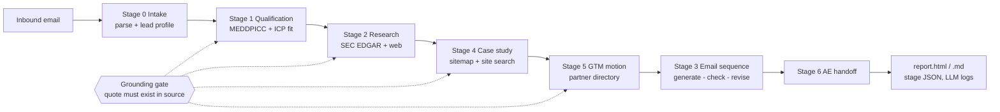

# Inbound Lead Agent — FlytBase BDR assignment

A Python agent that takes one raw inbound contact-form email and produces, end to end and without hand edits, the six artifacts an inbound BDR would: qualification, account research, an adaptive email sequence, a matched case study, a go-to-market recommendation and an AE handoff.

```
python run.py input/lead_sqm.txt
```

The output is `runs/<run_id>/report.html` (plus `report.md`), with every stage's JSON and every LLM prompt and response saved next to it.

---

## Architecture



| Layer | What it is | Where |
|---|---|---|
| Orchestrator | Plain Python, one module per stage, typed hand-offs (Pydantic) | `agent/pipeline.py`, `agent/stages/` |
| LLM | Claude (or OpenAI) forced to return one schema per call; validated, retried on failure | `agent/llm.py` |
| Tools | Web search (Tavily, DuckDuckGo fallback), page/PDF fetch, SEC EDGAR, sitemap crawler | `agent/tools/` |
| Grounding gate | Code (no LLM) checks every quoted claim against the fetched source text | `agent/evidence.py` |
| Rules & weights | ICP criteria, scoring weights, priority tiers, GTM rules | `agent/config.py` |
| Prompts | Every instruction given to the model | `agent/prompts.py` |
| Report | Jinja templates | `agent/templates/` |

**Division of labour.** The LLM does reading and judgement: extracting facts, scoring rubrics, writing. Code does everything that has to be reliable: discovery, verification, scoring, ranking, routing decisions and consistency checks. Each stage is LLM → verify → compute, so a reviewer can see exactly which number came from where.

**Why Stage 3 runs fifth.** The emails have to use the research, the case study and the partner plan, so the sequence is generated after Stages 4 and 5. Stage numbering follows the brief; execution order follows the data.

---

## What each stage does

**Stage 0 · Intake.** A regex parser splits the form fields. The LLM builds a lead profile: industry, use case, site count, operating conditions, referral entities, region markets and matching keywords. Every later stage keys off this profile, so nothing about SQM, Anglo American or Chile is hard-coded.

**Stage 1 · Qualification (MEDDPICC).**
- The LLM assesses all eight elements and the eight ICP criteria. Each judgement must quote the email.
- Code verifies each quote. A "confirmed" with no real quote is downgraded, and the downgrade is listed under *Grounding checks*.
- Code then computes ICP fit (0–100, weights in `config.py`), MEDDPICC completeness (0–16) and priority tier.
- Ambiguities are flagged explicitly. For example, "budget conversation in Q3" is checked against today's date.

**Stage 2 · Account research.**
1. **SEC EDGAR.** The company is resolved to a CIK via full-text search over every name variant. SQM is filed under the English name "Chemical & Mining Co of Chile", which a simple name match misses. The system then fetches the latest 20-F / 10-K and recent 6-Ks.
2. **Web search.** The LLM plans queries per dimension: org structure, budget signals, news, stakeholder letters. Code guarantees coverage, runs the searches and fetches the pages.
3. **Excerpting.** Long documents are cut to keyword-windowed excerpts so a 1M-character filing fits in a prompt.
4. **Extraction.** The LLM extracts findings as `{claim, source_id, verbatim quote, so_what}`.
5. **Grounding gate.** Code verifies each quote against the source text. Failures are dropped and listed in the appendix as rejected claims.
6. **Sender check.** The system searches for the sender by name and company. If no page ties him to the company, the report says he is *not publicly verified* rather than inventing a profile.
7. **Positioning.** Synthesised from verified findings only, citing finding ids. Stakeholders are labelled `verified` or `inferred_from_role`, and the model may not invent names.

**Stage 4 · Case study matching.**
- **Discovery:** `robots.txt` → sitemap index → every child sitemap → default-language URLs, with translated duplicates removed. The system also runs site-restricted searches for each referral entity named in the email.
- **Ranking:** slug pre-rank, then page features (referral mentions, keyword share, region mention, section credibility). The LLM scores a rubric for the top 10, each score backed by a verified quote. Code computes the final weighted score.
- **Why it matters:** the referral material is not necessarily in the "case studies" section. On flytbase.com, the Anglo American story is a blog post and a webinar about a docked-drone deployment at Quellaveco, Peru, so a matcher that only reads `/case-studies` misses it.

**Stage 5 · Partner identification & GTM motion.**
- **Discovery:** partner pages are found from homepage navigation links, sitemaps and site search, so a directory page is found even if no sitemap lists it.
- **Extraction:** the LLM extracts each partner's name, country, tier and type, verified against the page text.
- **Decision:** code scores deal complexity on seven factors and applies explicit rules: complexity × partner availability → motion.
- **Shortlist:** partners are ranked on country, region, system-integrator type, tier, and whether they are named in the matched reference deployment.
- **Rationale:** the LLM writes the explanation but cannot change the decision.

**Stage 3 · Email sequence.**
- The LLM writes four emails plus reply branches.
- A deterministic checker requires that:
  - every email cites a verified finding;
  - every open MEDDPICC element is targeted somewhere in the sequence;
  - the recommended proof content is used;
  - word limits are respected and there are no placeholders.
- Failures go back to the LLM for up to two revisions, and any issues still open are shown in the report.

**Stage 6 · AE handoff.**
- **LLM-written:** buyer context, top 3 findings (by id, validated) and the next step with owner, timing and agenda.
- **Copied by code:** qualification numbers, case study and GTM motion, so they cannot drift from earlier stages.

---

## Setup

```bash
python -m venv .venv && source .venv/bin/activate        # Windows: .venv\Scripts\activate
pip install -r requirements.txt
cp .env.example .env                                      # then fill in keys
```

| Need | Free option | Paid option |
|---|---|---|
| LLM | Google Gemini free tier (key from AI Studio) or a local model via Ollama; any OpenAI-compatible endpoint works through `LLM_PROVIDER=openai` + `OPENAI_BASE_URL` | Anthropic (`ANTHROPIC_API_KEY`) |
| Web search | Tavily free plan (1,000 credits/month, no card; a run uses ~50). With no key, DuckDuckGo is used. | Tavily paid |
| SEC filings | Always free: set `SEC_USER_AGENT="Your Name you@email.com"` (SEC asks callers to identify themselves; no signup) | — |

`.env.example` has ready-to-uncomment blocks for each option. On free tiers, set `LLM_MIN_SECONDS_BETWEEN_CALLS` and `LLM_PARALLEL_CALLS=1` to stay under rate limits; a run then takes longer but costs nothing. Endpoints that do not support JSON mode are handled automatically: the agent falls back to parsing JSON from plain text, and schema validation plus retries still apply. Smaller local models make more mistakes, but the grounding gate still removes any claim whose quote is not in the source.

Run:

```bash
python run.py input/lead_sqm.txt              # live run, typically a few minutes and 15–20 LLM calls
python run.py input/lead_sqm.txt --no-cache   # ignore cached fetches (fresh research)
python run.py input/lead_sqm.txt --mock       # offline wiring test: fake LLM + fake web, placeholder output
python -m pytest -q                           # unit tests + scripted end-to-end test
```

Any other lead works the same way. Write a file in the same `Field: value` format (or JSON) and pass its path.

### Output folder

```
runs/<run_id>/
  report.html          ← the live run output (all six stages)
  report.md
  stages/00..06_*.json ← typed output of each stage
  llm_calls/NNN_*.json ← every prompt, response, token count, validation result
  sources.jsonl        ← every document the agent read (id, url, text)
  run_log.jsonl        ← searches, fetches, warnings, timings
  run_meta.json
```

---

## Design decisions

- **Grounding gate in code, not in the prompt.** "Do not hallucinate" in a prompt is a request; a substring check is a guarantee. Every research finding, rubric score, partner and MEDDPICC judgement carries a quote, and `verify_quote()` checks it with normalisation plus fuzzy matching at ≥90. The gate is unit-tested with fabricated claims. Rejected claims are shown, not hidden, so the reviewer can see the gate working.
- **LLM judges, code decides.** Fit score, priority, case-study ranking and GTM motion are formulas and rules in `config.py`. Change a weight and the decision changes predictably, which makes the output auditable and easy to tune with a sales manager.
- **Discovery over assumptions.** Sitemaps, navigation links, site search and EDGAR full-text search are used to find things wherever they actually are, which is how the non-obvious placements described above are handled.
- **Typed contracts.** Each stage reads and writes Pydantic models, so a malformed LLM response fails fast and is retried with the validation error, instead of corrupting later stages.

## Limitations and what I'd improve

- **Sender verification is limited to the open web.** LinkedIn and paid data (Apollo, ZoomInfo) would give better org charts; the agent says "unverified" instead of guessing.
- **One-shot run, no CRM.** Production would trigger on form submission (webhook), write to HubSpot/Salesforce and post the handoff to Slack. The stage modules would not need to change for that.
- **The sequence is generated, not sent or tracked.** Real adaptivity means re-running Stage 3 on each reply. The reply branches are the policy for that.
- **Search quality depends on the provider.** DuckDuckGo fallback results are noticeably weaker than Tavily's.
- **Quote verification proves a statement appears in the source, not that the model interpreted it correctly.** An LLM-as-judge pass or human spot-check would cover interpretation.
- **Evaluation.** A small labelled set of past inbound leads would let the ICP weights and priority tiers be calibrated rather than set by judgement.

## Why MEDDPICC

This is an enterprise, multi-site deal with a listed mining company. The things that kill such deals are procurement (Paper Process), an unidentified economic buyer and a missing internal champion, not whether the lead has "budget". The email gives a referral (possible champion path), a stated pain and a vague budget timeline: exactly the signals MEDDPICC separates and BANT collapses. SPICED suits high-velocity recurring sales better than a long industrial procurement cycle.

## Repository map

```
run.py                       CLI
agent/pipeline.py            orchestrator, run folder, report
agent/config.py              ICP, weights, rules, budgets
agent/prompts.py             all prompts
agent/schemas.py             stage contracts
agent/evidence.py            evidence store + grounding gate
agent/llm.py                 structured LLM calls (Anthropic / OpenAI / mock)
agent/tools/web.py           search + fetch + cache
agent/tools/sec.py           SEC EDGAR resolution and filings
agent/tools/site.py          sitemap / language / section helpers
agent/stages/s0..s6_*.py     the stages
agent/templates/             report templates
tests/                       unit tests + scripted end-to-end test
```
